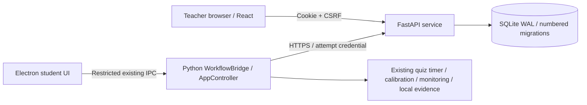

# Teacher Dashboard — Stage 1

This stage adds a separate teacher website, a local Python HTTP service and an
explicit connected mode in the existing Electron student application. The legacy
desktop entry points remain available. No Stage 2 synchronization, screen viewing,
remote proctor commands, public deployment or Windows packaging was implemented.

## Architecture and authority



The server is a separate process and environment, not part of the camera worker.
It uses per-operation SQLite connections, foreign keys, `BEGIN IMMEDIATE` writes
and database uniqueness constraints. These serialize competing admissions and
teacher grants without creating a second desktop lifecycle engine. Numbered SQL
migrations make later additions incremental. This choice targets one development
host; 30-student throughput and Internet exposure have not been verified.

Teachers have hashed, random HttpOnly sessions with expiry, SameSite cookies,
CSRF checks and exact-origin checks. Cookies are Secure by default. Invitations
and resets are expiring, single-use random links generated only from the server
CLI; only their hashes are stored. Passwords use salted scrypt. Reset invalidates
existing sessions. Teacher-owned queries protect libraries, exams and attempts
on the backend. There is no admin website or public registration.

The website uses the existing sand/moss palette, rounded cards, locally bundled
Nunito/Inter fonts and EN/RU/KK text. Its home is an exam list. Counts are persisted
admissions/attempts, never fabricated live monitoring counts. Attempt results sent
by the desktop are explicitly **client-reported**, not independently verified.

## Pages and contracts

- Invitation acceptance, login, logout and password reset.
- Exam list, grouped by server-provided phase, with admission times, timezone,
  code, duration, type and recorded counts.
- Private library: XLSX/JSON upload, validated preview and explicit save.
- Exam creation: native/external content, admission window, timezone, duration,
  shuffle settings, audio, snapshots and requested workstation protection mode.
- Exam detail and associated attempts, including reasoned preparation extensions
  and authorized repeats of finished or expired, unstarted attempts.

The [server guide](../server/README.md) documents every `/api/v1` endpoint and
the import schema. [JSON](../server/samples/questions.json) and
[XLSX](../server/samples/questions.xlsx) samples are included. IDs are stable;
question sets are copied into exams and shuffled once into frozen attempt
snapshots. An imported question is always one point; multiple choice requires
the exact answer set. There is no partial credit or passing threshold.

Imports are bounded by file size, question/option counts and a 64 KiB public quiz
projection so an accepted set fits the existing bounded desktop bridge. XLSX
formulas are rejected, not executed. Answer keys reach only the authenticated
Python attempt client, never the Electron renderer or student score screen.
A modified local process can still inspect its own answer keys; this stage does
not claim anti-tamper or server-verified grading.

## Student integration

`config/connected.example.toml` explicitly enables connected mode. The student
verifies the server, enters exam code, full name, group and institutional Student
ID, then receives a per-attempt credential. Only a successfully verified server
origin is remembered. The credential stays in Python memory, outside renderer
state, evidence and logs. Student ID alone cannot reconnect or control an attempt.

The server checks admission with server time and atomically enforces a first
attempt or consumes a reasoned repeat grant. Preparation initially lasts 300
seconds. An admitted student can finish preparation after admissions close, but
cannot start after the preparation deadline. The teacher can add five minutes,
with a required reason recorded in the audit history; the student refreshes the
extension in the existing preparation UI.

The server policy is validated and applied before media consent/setup. The
existing device selection, optional reference photo, gaze calibration and local
readiness remain necessary. Start authorization runs on a bounded background
HTTP worker; readiness is checked again before Python starts the exam. Network
loss after that start cannot itself pause the timer, end the exam or create an
event. Ordinary local monitoring failures retain their existing behavior.

The native quiz supports free navigation, answer changes, exact-set multiple
choice, early submission with unanswered count, existing timed completion, and
immediate score/percentage. External exams retain the existing isolated
WebContents view: ending local monitoring does not submit the website's answers.

Connected mode cannot turn an unprotected launch into a protected one. A policy
mismatch blocks preparation/start with an explanation; protected operation still
requires explicit local configuration and a current matching recovery audit.
This stage changes source identity. Old rc8 reports remain historical evidence
and do not authorize protection for the updated source.

## Local startup — Windows PowerShell

Run three terminals. These commands intentionally use an explicit **loopback-only
HTTP development exception**; remote server addresses require HTTPS with valid
certificate verification. They do not enable Windows blocking.

### 1. Server

```powershell
Set-Location 'C:\Users\kuten\Desktop\case3_proctoring'
# First setup only:
py -3.11 -m venv .venv-server
.\.venv-server\Scripts\python.exe -m pip install -r server\requirements.lock.txt

. .\server\environment.example.ps1
.\.venv-server\Scripts\python.exe -m proctoring_server migrate
.\.venv-server\Scripts\python.exe -m uvicorn proctoring_server.app:create_app --factory --host 127.0.0.1 --port 8000 --no-access-log --no-proxy-headers
```

In another shell with the same environment, create an invitation for an address
you control. The command prints a link; it does not send email:

```powershell
Set-Location 'C:\Users\kuten\Desktop\case3_proctoring'
. .\server\environment.example.ps1
.\.venv-server\Scripts\python.exe -m proctoring_server invite --email teacher@example.edu
# For an existing teacher's password reset:
.\.venv-server\Scripts\python.exe -m proctoring_server reset --email teacher@example.edu
```

### 2. Teacher website

```powershell
Set-Location 'C:\Users\kuten\Desktop\case3_proctoring\teacher-web'
npm ci
npm run dev
```

Open `http://127.0.0.1:5174`. The development proxy targets port 8000. Keep the
configured browser origin exact; substituting `localhost` in only one place will
fail the origin/cookie checks. For a private proxy override, copy `.env.example`
to `.env.local`. No API credentials belong in frontend environment variables.

### 3. Student source application

```powershell
Set-Location 'C:\Users\kuten\Desktop\case3_proctoring\desktop'
npm run build
npm start -- --config config/connected.example.toml
```

The existing Python `.venv` and local models are still required for actual
camera/calibration work. Standalone source launch remains:

```powershell
npm start -- --config config/default.example.toml
```

Do not run both desktop frontends against the same devices. No private TOML file
is replaced by these commands. Database files and isolated environments are
ignored by Git. Back up the private server database before future migrations.

## Short manual verification (not performed as a hardware test in this stage)

1. Start server and website; accept a CLI invitation and sign in. Change EN/RU/KK.
2. Import the JSON or XLSX sample, inspect its preview and explicitly save it.
3. Create a native exam with admission open now, correct timezone and
   **Unprotected** policy; note the shared code.
4. Launch connected student mode, verify `http://127.0.0.1:8000`, and join with
   a test institutional ID. Complete normal setup/calibration; no gates are bypassed.
5. Optionally let preparation expire: Start must stay blocked. Grant five minutes
   with a reason in the teacher page, refresh in the student app, then start.
6. Change single/multiple answers and navigate freely. Submit early; verify the
   unanswered count and final score without exposed correct answers.
7. Refresh the teacher attempt list. An acknowledged result is client-reported.
   In a separate later manual check, stopping the server after local Start must
   leave the local exam functioning; missing completion delivery is not a pass.
8. Reusing the same Student ID must be refused until the teacher grants a repeat
   with a reason (the admission window must still be open).

For an external exam, verify the allowed site in the isolated view; explicitly
submit any website answers there before ending local monitoring. No LMS-specific
authentication flow has been verified.

## Main file groups

| Area | Main files |
|---|---|
| Server and persistence | `src/proctoring_server/{app,service,security,settings,database,imports,__main__}.py`, `migrations/001_foundation.sql` |
| Server setup and samples | `server/environment.example.ps1`, `requirements.lock.txt`, `samples/questions.{json,xlsx}`, `server/README.md` |
| Teacher website | `teacher-web/src/{App.tsx,api.ts,i18n.tsx,time.ts,styles.css}`, independent package/lock and test configuration |
| Student connection | `src/proctoring/connected/`, `desktop_bridge/{workflow,protocol}.py`, `config/connected.example.toml` |
| Student presentation | Narrow Electron contracts/preload validation, connected join/preparation UI, quiz and summary screens, EN/RU/KK strings |
| Shared compatibility | `exam/quiz.py`, configuration, candidate/session metadata, report and remote-message name formatting |
| Targeted tests | `tests/teacher_server/`, `tests/test_connected_*.py`, `tests/test_question_sets.py`, new teacher and connected desktop UI tests |

This workspace already contained unrelated, uncommitted changes before Stage 1.
The complete `git status` output is not a Stage 1 change list. Private configuration,
historical audit reports, Git history and published releases were preserved.

## Executed verification — 14 October 2026

| Selected checks | Actual result |
|---|---|
| New server foundation tests | 58 passed before the final token-validation correction, zero skipped |
| Final focused authentication regression | 21 passed, zero skipped, including 9 added checks; other server files were not rerun after this narrow correction |
| Connected client/workflow/API plus affected configuration/registration/local workflow | 117 passed; includes 3 real loopback HTTP tests with temporary SQLite and simulated device readiness |
| Shared quiz and candidate-label tests | 51 passed |
| Teacher website unit tests | 8 passed |
| Teacher website browser workflows | 5 passed against real FastAPI/SQLite; 2 affected workflows passed again after final accessibility/import-preview fixes |
| Connected desktop TypeScript tests | 5 passed |
| Connected desktop browser tests | 4 passed with mocked devices/bridge presentation |
| Affected source builds | Teacher TypeScript/Vite and desktop TypeScript/Vite/Electron source bundling passed |
| Separate HTTP smoke | CLI invite, login, XLSX preview/save, exam/admit/start/finish, teacher result and logout passed; owned server exited |

The HTTP smoke record is in ignored
`build/teacher-api-smoke-28e0ac0c/result.json`. Teacher screenshots are under
`teacher-web/test-results/`; EN desktop and KK 375px layouts were visually checked.
Test servers and owned browser workers were closed. No persistent demo account or
student attempt was seeded into the normal server database.

Final review corrected invitation/reset processing to reject invalid, expired or
used links before expensive password hashing. Password hashing stays outside the
write transaction, followed by a transactional token recheck. The 21-test auth
run verifies concurrent one-use consumption and expiry while hashing. The server
checks emitted one non-failing Starlette/httpx deprecation warning.

Exact focused commands used (from repository root unless shown otherwise):

```powershell
. .\server\environment.example.ps1
.\.venv-server\Scripts\python.exe -m pytest --confcutdir=tests/teacher_server tests/teacher_server -q
.\.venv-server\Scripts\python.exe -m pytest --confcutdir=tests/teacher_server tests/teacher_server/test_auth.py -q
.\.venv\Scripts\python.exe -m pytest tests/test_connected_client.py tests/test_connected_workflow.py tests/test_connected_live_api.py tests/test_desktop_workflow.py tests/test_registration_config.py tests/test_config.py -q
.\.venv\Scripts\python.exe -m pytest tests/test_quiz.py tests/test_question_sets.py tests/test_connected_candidate_labels.py -q

Set-Location .\teacher-web
npm test
npm run test:ui
npm run build

Set-Location ..\desktop
npx tsx --test tests/connected.test.ts
npx playwright test tests/ui/connected.spec.ts
npm run build
```

These commands document completed verification; they are not a request to rerun
everything for normal startup. The main Python suite, all Electron tests, the
existing Playwright suite, native audits/blocking, physical devices/operator exams,
packaging and load tests were intentionally not executed.

A clean teacher `npm ci` remains unverified because registry DNS/cache access
failed. Build and browser checks used matching official packages copied into its
independent `node_modules`; desktop dependencies were not changed or junctioned.
The separate server environment installed successfully from official PyPI after
a process-local DNS resolution workaround with normal TLS verification. Neither
workaround is part of application runtime code.

## Limits and next stage

- Teacher result delivery is one best-effort metadata request. There is no durable
  queue, retry scheduler, evidence upload, verified server receipt or local deletion.
- Attempt credentials are memory-only. A lost admission response or closed
  preparation process may need teacher repeat authorization after expiry. A lost
  start response/crash after server authorization can leave a server-started
  attempt without a running local exam. Same-device recovery and resolving that
  state through teacher authority are not implemented here.
- Deadline handling is conservative: local Start remains blocked if its mapped
  preparation deadline expires while authorization is in flight. A server-side
  recorded start is not proof that the student app actually began.
- Native security algorithms, camera/gaze/audio algorithms, event thresholds,
  timer and monitoring recovery were not redesigned. Protected audits and human
  hardware tests were deliberately not run. Packaging remains paused.
- No public deployment, 30-student load result, WebRTC/screen viewing, remote
  commands or complete offline synchronization is claimed.

Recommended Stage 2: durable idempotent event/evidence outbox and server receipts,
teacher-owned review decisions and reports, explicit pending/synced status, and
tested retry/reconnection behavior. Design retention for 30 days after completion
and delete local evidence only after verified complete receipt. Screen viewing,
remote controls and native protection/load deployment checks remain later stages.
